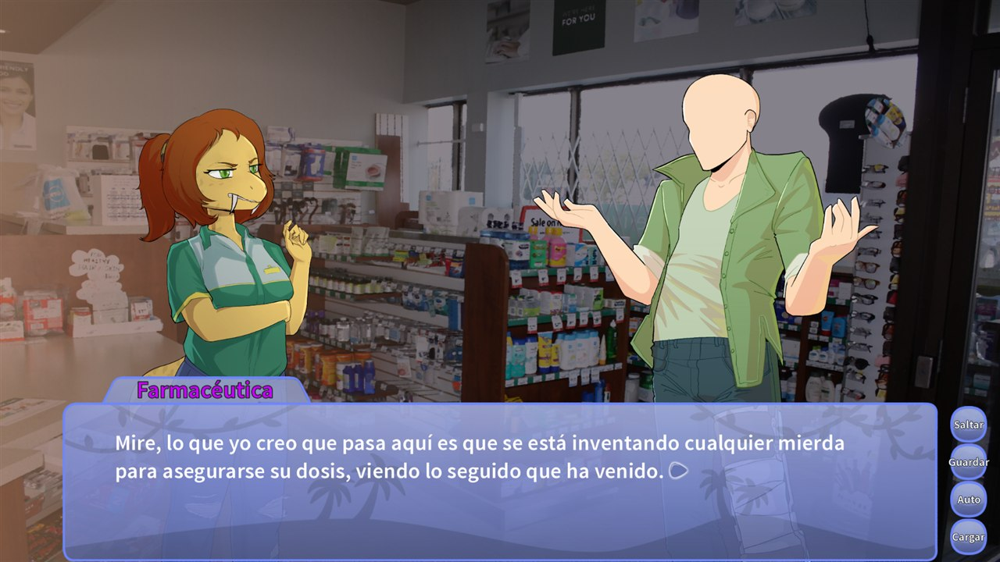
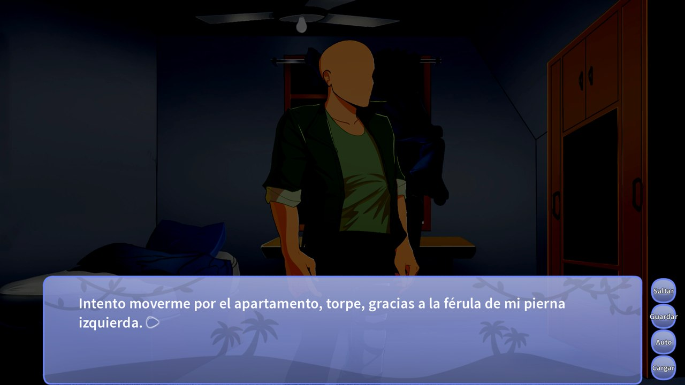
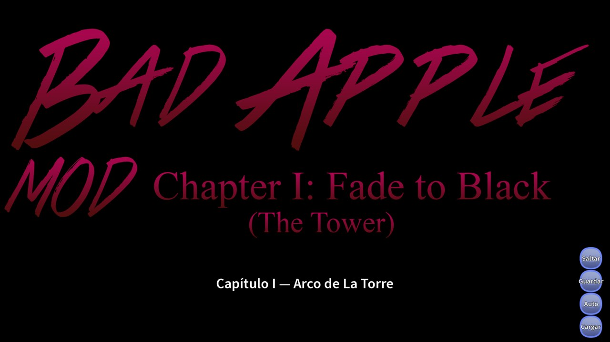
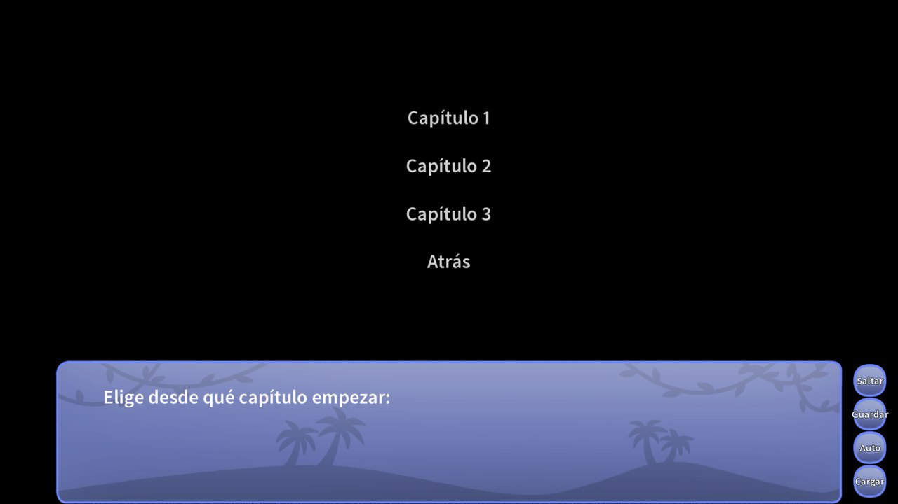

# Bad Apple en español (parche no oficial)

Traducción de fans al español latinoamericano de **Bad Apple**, el mod de Team Starlight para Snoot Game, basado en el fanfic de Umbruhh. Los seis capítulos de los arcos «La Torre» y «Los Enamorados»: todo el diálogo y la narración, el menú de capítulos, los nombres de los personajes y los textos en pantalla.



> **Solo es el parche.** Aquí no hay ningún archivo del mod ni del juego: únicamente los archivos de traducción y sus instrucciones. El mod se descarga aparte.

> **Aviso de contenido.** Bad Apple continúa el final 1 de Snoot Game (y lo destripa). Es una historia para adultos sobre lo que queda después de un tiroteo en una escuela: duelo, culpa, dependencia de pastillas, ideas suicidas, violencia y lenguaje fuerte. La traducción no suaviza nada.

## Descarga

**[Descargar el parche (última versión)](../../releases/latest)**. Pesa menos de 200 KB.

Necesitas tener ya instalados:

- Snoot Game Patch 14 «Munich Agreement» para Windows.
- Bad Apple en su versión de dos arcos (seis capítulos), en la carpeta `game\mods\BadAppleMod\`. En el [archivo de mods de la comunidad](https://mods.snootbooru.com/snoot/) es el archivo `Bad Apple.zip`.

## Instalación

**No se reemplaza ni se borra ningún archivo.** El parche solo añade, dentro de la carpeta del mod que ya tienes, una carpeta nueva llamada `es` y un archivo nuevo llamado `metadata_es.json`.

1. Si todavía no tienes el mod, instálalo primero: descomprímelo dentro de `game\mods\`, de modo que exista `game\mods\BadAppleMod\metadata.json`.
2. Cierra el juego.
3. Descomprime `BadApple-ES-1.0.zip`. Dentro hay una carpeta llamada `BadAppleMod`.
4. Copia esa carpeta `BadAppleMod` dentro de `game\mods\`. Windows avisará de que ya existe una carpeta con ese nombre y preguntará si quieres combinarlas: di que sí. No preguntará por reemplazar archivos, porque no hay ninguno repetido.
5. Abre el juego y pon el idioma en **Español** (menú `Language`).
6. Entra en **Mods**. Si Bad Apple sale apagado, marca la casilla que tiene a su izquierda y pulsa **Recargar Mods**. Después pulsa **Bad Apple**.

Así debe quedar:

```
SnootGame-Patch14-MunichAgreement-win\
└── game\
    └── mods\
        └── BadAppleMod\               <- la carpeta del mod (ya la tenías)
            ├── assets\
            ├── badapple.rpym
            ├── metadata.json
            ├── metadata_es.json       <- lo añade el parche
            └── es\                    <- lo añade el parche
                ├── ba_chp1_es.rpym
                ├── ...
                └── ba_rotulos_es.rpym
```

La primera vez que abras el juego aparecerán solos unos archivos `.rpymc` dentro de `es`. Es normal: los crea el juego.

### Si algo no va

| Qué pasa | Qué hacer |
|---|---|
| Sigue en inglés y el juego estaba abierto cuando copiaste el parche | Ciérralo y vuelve a abrirlo |
| Sigue en inglés y el juego no está en español | Menú `Language` → **Español** |
| La carpeta quedó una dentro de otra (`BadAppleMod\BadAppleMod\es\`) | Sube `es` y `metadata_es.json` un nivel, como en el esquema |
| El mod no aparece, o sale un aviso de que «no está instalado correctamente» | `metadata.json` tiene que estar en `game\mods\BadAppleMod\`, no una carpeta más adentro |
| No sale la caja de diálogo y aparece el texto `Couldn't find file 'gui/textbox_long.webp'` | No es de este parche: pasa cuando el mod Age After Beauty está activado a la vez. Apágalo en el menú de mods mientras juegas Bad Apple |

### Para quitarlo

Cierra el juego y borra la carpeta `game\mods\BadAppleMod\es\` y el archivo `game\mods\BadAppleMod\metadata_es.json`. El mod vuelve a verse en inglés y no cambia nada más. Tus partidas no se tocan.

## Así se ve

| | |
|---|---|
|  |  |



Capturas del juego con el parche puesto, del principio de la historia para no destripar nada. El arte del mod es de Team Starlight; los fondos y la interfaz son de Snoot Game (Cavemanon, CC BY-SA 4.0).

## Qué está traducido

| Parte | Estado |
|---|---|
| Diálogo y narración de los seis capítulos | 3704 líneas |
| Menú de arcos y capítulos | Completo |
| Nombres de personajes secundarios y textos sueltos en pantalla | Completos |
| Nombre y descripción en el menú de mods | En español |
| Tarjetas de capítulo y cartel final | Con subtítulo en español; la imagen no se toca |

Lo que se deja en su idioma, a propósito:

- Los títulos de los capítulos, las marcas (que son parodias) y los títulos de anime y de juegos.
- La letra de una canción que aparece en el capítulo 2 (4 líneas): se muestra como en el original.
- La voz de la máquina de peleas del arcade, el francés de la familia Baudelaire y el japonés de Stella.
- Las cartas del tarot dibujadas y los créditos finales, que son arte de los autores.

Los términos del universo (carfe, skinnie, «Jesús Raptor»...) siguen a la traducción al español que ya trae Snoot Game, para que el mod suene igual que el juego.

Las [notas del traductor](NOTAS-DEL-TRADUCTOR.md) explican las decisiones y las referencias que el español no puede cargar solo, sin destripes.

## Hecha con IA, y qué quiere decir eso

Esta traducción la hizo una inteligencia artificial (Claude, de Anthropic), dirigida y publicada por un fan. Va dicho de entrada para que sepas qué estás descargando.

No es una traducción automática frase por frase. Se trabajó así:

- Antes de traducir se leyeron los seis capítulos enteros para fijar la voz de cada personaje, quién tutea a quién, el vocabulario y las frases que vuelven a lo largo de la historia.
- Cada capítulo pasó después por una revisión independiente, también con IA, que comparó cada línea con el original. Salieron 131 observaciones y se corrigieron 175 líneas.
- Se recorrió el mod entero dentro del juego real para comprobar que todas las líneas salen en español y que ningún texto se sale del cuadro.

Lo que no tiene es una corrección completa hecha por una persona, ni una partida jugada de principio a fin con calma, así que puede quedar alguna frase rara o un matiz perdido. Si encuentras algo, [abre un aviso](../../issues) con la frase y se corrige.

## Otras traducciones

En el archivo de mods de la comunidad hay también un `Bad Apple-ES.zip`, de enero de 2026, anterior a la versión de dos arcos. Este parche es un trabajo independiente: no parte de esa versión ni usa nada de ella.

## Créditos

- **Bad Apple:** Team Starlight, sobre el fanfic del mismo nombre de Umbruhh. Los créditos completos del equipo están al final del mod.
- **Snoot Game:** [Cavemanon](https://git.cavemanon.xyz/Cavemanon/SnootGame).
- **Traducción:** hecha con Claude (Anthropic) y publicada por un fan. Es gratis y no hay donaciones ni nada que comprar: se hizo por gusto, para que el mod se pueda disfrutar en nuestro idioma.

Este parche no es oficial ni tiene relación con los autores. Si eres de Team Starlight y prefieres que se retire, o quieres incluirlo en el mod, basta con decirlo.

## Licencia

El mod y su texto original son de sus autores. Snoot Game comparte su contenido bajo CC BY-SA 4.0, y esta traducción se ofrece en esos mismos términos: puedes copiarla y mejorarla dando crédito y manteniendo la licencia. El texto completo está en [LICENSE](LICENSE).

---

**English:** Unofficial Latin American Spanish fan translation patch for Team Starlight's *Bad Apple*, a Snoot Game mod based on Umbruhh's fanfic. AI-made (Claude), reviewed chapter by chapter and tested in-engine, not human-proofread. It adds translation files inside the mod folder and does not include, replace or modify any mod file. All credit for the original work belongs to its authors.
